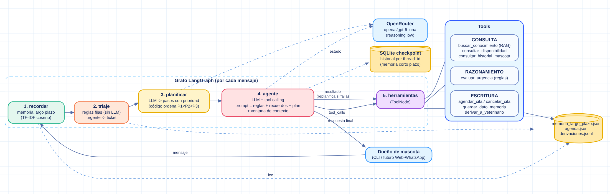

# Agente Patitas Felices EV2

Agente conversacional para la Veterinaria Patitas Felices (Rancagua) construido con **LangGraph** y un LLM vía **OpenRouter**. Evoluciona el pipeline RAG de la EV1 a un agente que **consulta, escribe y razona**, con **memoria de corto y largo plazo** y **planificación**.

**Integrantes:** María Fernanda Calfileo, Vicente Concha, Sandra Chamorro · 

**Docente:** Juan Burgueño



## Qué hace el agente
Responde consultas de la clínica, agenda y cancela citas, deriva a un veterinario humano ante síntomas o accidentes (nunca diagnostica ni da dosis) y recuerda datos durables del dueño entre sesiones.

## Estructura del repositorio
```
Veterinaria_Patitas_Felices/
├── README.md
├── arquitectura_patitas_felices.png
├── Ev1/                      # Evaluación 1: asistente RAG
│   ├── asistente_rag.py
│   ├── arquitectura.png
│   ├── README.md
│   └── evidencia/
└── EV2/                      # Evaluación 2: agente (este proyecto)
    ├── main.py
    ├── requirements.txt
    ├── README.md
    ├── .gitignore
    ├── arquitectura_patitas_felices.png
    ├── agente_patitas/       # grafo, tools, memoria, agenda, conocimiento
    ├── tests/                # 10 pruebas de orquestación
    └── evidencia/            # pruebas_pytest.txt y demo_llm_real.txt
```

## Ejecución
```bash
pip install -r requirements.txt
export OPENROUTER_API_KEY='tu-key'      # Linux/Mac. En Windows (CMD): set OPENROUTER_API_KEY=tu-key
                                        # nunca la escribas en el código ni la subas al repo
python main.py --demo                   # 5 escenarios con la traza completa
python main.py                          # chat interactivo
python -m pytest -v tests               # pruebas de orquestación (sin red ni costo)
```
Variables opcionales: `OPENROUTER_MODEL` (por defecto `openai/gpt-6-luna`), `MAX_TOKENS_CONTEXTO` (por defecto 1500). Los datos persistentes quedan en `datos/` (se crea solo; bórrala para empezar de cero).

## Arquitectura (IE1, IE2, IE8)
Por cada mensaje, el grafo (`agente_patitas/grafo.py`) recorre: `recordar → triaje → planificar → agente ⇄ herramientas → fin`.

| Nodo | Qué hace |
|---|---|
| `recordar` | Recupera recuerdos del dueño por similitud semántica (memoria de largo plazo). |
| `triaje` | Reglas fijas (sin LLM): si el mensaje tiene señales urgentes, crea el ticket de derivación en código. El agente recibe el resultado y no puede olvidar ni inventar la derivación. |
| `planificar` | El LLM descompone la petición en pasos con prioridad (1 = urgente); el código los ordena. |
| `agente` | LLM con *tool calling*. Su prompt incluye reglas, recuerdos, plan y una ventana recortada del historial. |
| `herramientas` | `ToolNode` ejecuta las tools; el resultado vuelve al agente, que replanifica si un paso falla. |

### Herramientas (`agente_patitas/tools.py`)
| Tipo | Tool | Efecto |
|---|---|---|
| Consulta | `buscar_conocimiento` | RAG (TF-IDF + coseno) sobre FAQ, horarios, vacunas, guía SAG |
| Consulta | `consultar_disponibilidad` | Horas libres de una fecha |
| Consulta | `consultar_historial_mascota` | Vacunas y última consulta |
| Razonamiento | `evaluar_urgencia` | Clasifica URGENTE / MODERADA / RUTINA con reglas (no diagnostica) |
| Escritura | `agendar_cita`, `cancelar_cita` | Modifica `agenda.json`; si la hora está ocupada devuelve alternativas |
| Escritura | `guardar_dato_memoria` | Escribe memoria de largo plazo |
| Escritura | `derivar_a_veterinario` | Registra un ticket en `derivaciones.jsonl` |

**Cómo elige el agente la tool:** tool calling nativo del LLM. Recibe el nombre, los argumentos y el *docstring* de cada tool, y decide según la petición, el plan y las reglas del prompt.
**Cómo agregar una tool:** escribir una función con `@tool` y un docstring claro, y añadirla a la lista de `crear_tools()`. No cambia el grafo.

## Memoria (IE3, IE4)
- **Corto plazo:** historial completo por `thread_id` en SQLite (`datos/historial.sqlite`, `SqliteSaver` de LangGraph). Sobrevive reinicios.
- **Ventana de contexto:** `ventana_de_contexto()` envía al LLM solo los mensajes más recientes que caben en `MAX_TOKENS_CONTEXTO`, empezando siempre en un mensaje del usuario para no separar un `tool_call` de su resultado. El turno en curso nunca se descarta. Lo viejo no se pierde: queda en SQLite y los datos durables pasan a la memoria de largo plazo.
- **Largo plazo:** `memoria_largo_plazo.json`, un recuerdo por dato durable y por dueño. La recuperación vectoriza los recuerdos con TF-IDF y devuelve los más similares a la consulta actual. Funciona entre sesiones distintas (otro `thread_id`).

## Planificación y decisiones adaptativas (IE5)
1. El nodo `planificar` produce pasos con prioridad y el código los ordena. Ante síntomas, el nodo `triaje` deriva primero (determinista) y el agente no agenda rutina.
2. Si `agendar_cita` falla por hora ocupada, la tool devuelve alternativas del mismo día y de otros días; el agente ajusta el plan y agenda otra hora sin rendirse.
3. `LIMITE_PASOS = 14` impide bucles infinitos de tools.

## Pruebas (evidencia en `evidencia/`)
- `tests/test_agente.py` (10 pruebas, `evidencia/pruebas_pytest.txt`): RAG, replanificación por hora ocupada, urgencia → derivación por triaje sin agendar, memoria entre sesiones y reinicios, persistencia en SQLite, ventana de contexto, parser del plan.
- Estas pruebas usan un LLM guionado (`tests/llm_falso.py`): validan la **orquestación** (grafo, tools, memoria), no la calidad del modelo.
- `evidencia/demo_llm_real.txt`: salida de `python main.py --demo` con el modelo real (OpenRouter), ejecutada por el grupo. Muestra los 5 escenarios: consulta con RAG, replanificación por hora ocupada, urgencia con derivación por triaje, y memoria de largo plazo entre sesiones.

En Windows, para que los acentos se guarden bien al redirigir la salida: `set PYTHONUTF8=1` antes de ejecutar.

## Decisiones de diseño (IE9)
| Decisión | Justificación |
|---|---|
| LangGraph | Grafo explícito y depurable, con checkpointer integrado y tools como nodos. Escala: se pueden añadir nodos y ramas sin reescribir. |
| OpenRouter (API compatible con OpenAI) | Permite cambiar de modelo con una variable; `reasoning: low` cuida el presupuesto. |
| Planificador separado | Hace visible el orden y la prioridad de las tareas; el código ordena, no se confía el orden al LLM. |
| Triaje por reglas antes del LLM | En una prueba real el LLM respondió “ya derivé” sin llamar a la tool de derivación. Por eso la derivación de urgencias es código determinista y auditable, y el prompt prohíbe afirmar acciones no ejecutadas. |
| TF-IDF en vez de embeddings | Reproducible, sin costo ni dependencias pesadas; el índice se aísla en `IndiceTfidf` y se reemplaza por embeddings + Chroma/FAISS sin tocar el resto. |
| SQLite + JSON | Persistencia sin servidor, suficiente para el prototipo. En producción: Postgres/Redis y base vectorial. |

## Limitaciones y trabajo futuro
Agenda e historial clínico son simulados. No hay canal web/WhatsApp. El conteo de tokens de la ventana es aproximado. Las tools podrían exponerse en un servidor aparte (MCP o API REST) para separarlas del agente.

## Uso de IA 
Se usó un asistente de IA para apoyar la generación de código y de borradores de documentación. Las decisiones técnicas, conclusiones y reflexiones individuales deben ser redactadas y validadas por el equipo.

## Referencias (APA)
- LangChain. (2025). *LangGraph documentation*. https://langchain-ai.github.io/langgraph/
- LangChain. (2025). *LangChain documentation: tools and chat models*. https://python.langchain.com/
- OpenRouter. (2025). *OpenRouter API documentation*. https://openrouter.ai/docs
- Lewis, P., Perez, E., Piktus, A., et al. (2020). Retrieval-augmented generation for knowledge-intensive NLP tasks. *Advances in Neural Information Processing Systems, 33*.
- Pedregosa, F., et al. (2011). Scikit-learn: Machine learning in Python. *Journal of Machine Learning Research, 12*, 2825–2830.